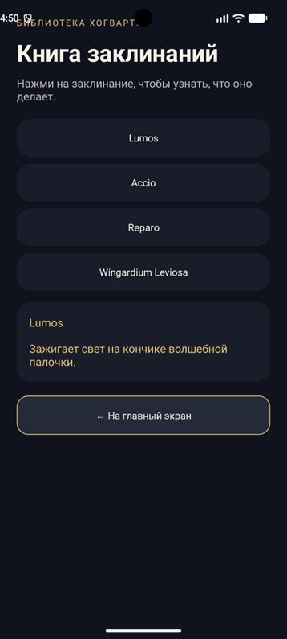

# Путеводитель по Хогвартсу

Учебное Android-приложение на Kotlin и XML. В приложении пять экранов: приветствие, выбор факультета, карточка факультета, книга заклинаний и короткая викторина.

## Экраны

1. На главном экране можно ввести имя и перейти к выбору факультета, книге заклинаний или викторине.
2. Список показывает четыре факультета.
3. Карточка факультета показывает его основателя, символ, гостиную и качества.
4. В книге заклинаний можно нажать на название и прочитать его описание.
5. В викторине нужно выбрать заклинание, которое зажигает свет. Ответ можно попробовать ещё раз.

